<a id="top"></a>

<h1 align="center">🔐 Keystead</h1>

<p align="center"><b>A self-hostable secrets manager for developers and small teams.</b><br>Keys, connection strings, certificates and tokens: kept in one place, fetched by name at runtime.</p>

<p align="center">
  
  
  
  
  
</p>
<p align="center">
  
  
  
  
</p>

<p align="center">
  <a href="#-quick-start"><b>Quick start</b></a> ·
  <a href="#-a-tour-of-the-app"><b>Tour</b></a> ·
  <a href="#-screenshot-gallery"><b>Gallery</b></a> ·
  <a href="#-architecture"><b>Architecture</b></a> ·
  <a href="#-security"><b>Security</b></a> ·
  <a href="#-testing-and-verification"><b>Verification</b></a> ·
  <a href="FINDINGS.md"><b>Findings</b></a>
</p>

<br>

<p align="center">
  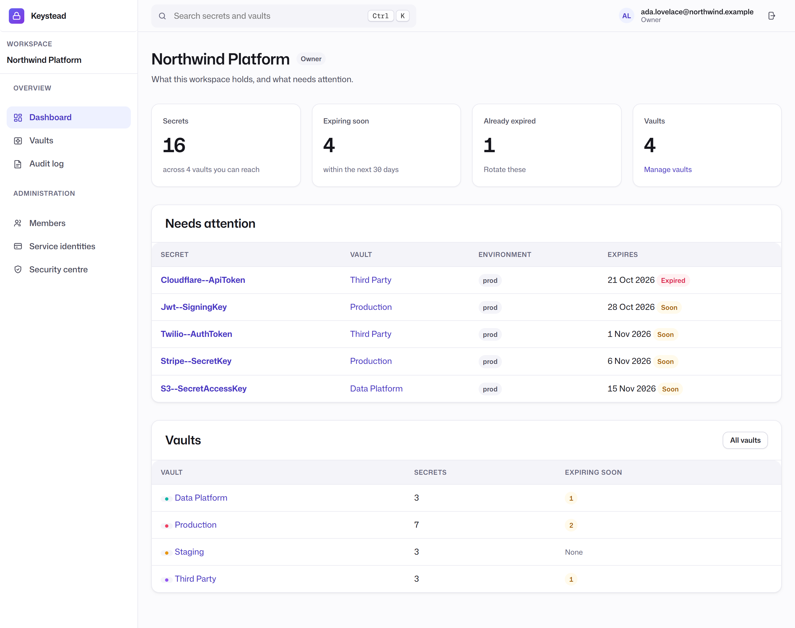
</p>

<br>

**Keystead** is a central place to keep API keys, connection strings, certificates and tokens, and a way for applications to fetch them at runtime by name, so nobody has to paste a connection string into a chat window again. People sign in with a password and a second factor, group secrets into vaults, and reveal a value only when they need it. Applications authenticate with their own credentials and read secrets through a one-line SDK or a CLI.

It is built on .NET 10, ASP.NET Core Razor Pages, EF Core and SQLite. It is comparable in concept to Azure Key Vault, scoped to something a small team can actually run on one box.

<table>
  <tr>
    <td align="center" width="25%"><h2>715</h2><sub>tests passing: 569 unit,<br>25 integration, <b>121 security</b></sub></td>
    <td align="center" width="25%"><h2>21</h2><sub>real attacks against a running<br>instance, <b>each refused</b></sub></td>
    <td align="center" width="25%"><h2>1,000</h2><sub>concurrent callers through<br>three load scenarios</sub></td>
    <td align="center" width="25%"><h2>3 tiers</h2><sub>of envelope encryption: master key,<br>vault key, per-version data key</sub></td>
  </tr>
</table>

<br>

## ✦ Highlights

<table>
  <tr>
    <td width="33%" valign="top">
      <h3>🗝️ Envelope encryption</h3>
      A master key wraps a per-vault key, which wraps a per-version data key, which seals the value. The master key never lives in the database, so a stolen database file is not a stolen secret.
    </td>
    <td width="33%" valign="top">
      <h3>👁️ Reveal on purpose</h3>
      Values are masked by default and never in the page markup. Revealing one is a <code>POST</code> behind a re-confirmed identity, is <code>no-store</code>, is written to the audit log, and hides again after 30 seconds.
    </td>
    <td width="33%" valign="top">
      <h3>⛓️ Tamper-evident audit</h3>
      Every read, write, sign-in, permission change and refusal is chained to the entry before it. An entry cannot be altered, inserted or removed without verification failing, and the page checks the chain on load.
    </td>
  </tr>
  <tr>
    <td width="33%" valign="top">
      <h3>🤖 Built for applications</h3>
      Service identities trade client credentials for a short-lived ES256 token scoped to their vaults. Rotation has an overlap window, there is an optional IP allowlist, and revocation bites on the next call.
    </td>
    <td width="33%" valign="top">
      <h3>🧩 One line in <code>Program.cs</code></h3>
      <code>AddKeystead(...)</code> plugs secrets into <code>IConfiguration</code>, so application code never mentions Keystead. <code>keystead run</code> injects them into a child process without touching a file.
    </td>
    <td width="33%" valign="top">
      <h3>🛡️ Deny by default</h3>
      Two factors, always, for administrators. Argon2id passwords, a strict nonce CSP from <code>default-src 'none'</code>, global antiforgery, and an authorization fallback that fails closed.
    </td>
  </tr>
</table>

<br>

## ✦ Quick start

> [!NOTE]
> **You need** the .NET 10 SDK. Python 3 is only needed for the seeding and verification scripts.

**1. Generate a master key** and export it.

```bash
export KEYSTEAD_MASTER_KEY=$(openssl rand -base64 32)
```

**2. Apply the schema and start the application.**

```bash
dotnet ef database update --project src/Keystead.Infrastructure
```

```bash
dotnet run --project src/Keystead.Web
```

**3. Create the workspace.** Open the application and the first-run wizard creates the workspace and the owner account. The wizard closes permanently once an account exists.

> [!IMPORTANT]
> The application **refuses to start** without a valid 256-bit master key. That is deliberate: starting without one would give you a process that looks healthy, accepts writes, and cannot decrypt anything it stored.

**4. Fill it with something to look at** (optional):

```bash
python scripts/seed-workspace.py https://localhost:5001
```

<details>
<summary><b>Using it from an application</b></summary>

<br>

**The SDK.** A secret stored as `ConnectionStrings--Default` is read the way any other setting is.

```csharp
builder.Configuration.AddKeystead(options =>
{
    options.Endpoint = new Uri("https://keystead.internal");
    options.ClientId = "orders-api-prod";
    options.ClientSecret = builder.Configuration["KEYSTEAD_CLIENT_SECRET"]!;
});

var connection = builder.Configuration.GetConnectionString("Default");
```

**The CLI.** `keystead secret list/get/set`, `env`, and `run`, which injects secrets into a child process and propagates its exit code.

```bash
keystead run --vault production -- dotnet MyApp.dll
```

</details>

<details>
<summary><b>Production deployment</b></summary>

<br>

The included [`Dockerfile`](Dockerfile) builds a chiselled, non-root image with a read-only root filesystem and all capabilities dropped. [`docker-compose.yml`](docker-compose.yml) runs it behind Caddy for TLS, with the master key mounted read-only from a file rather than passed as an environment variable. Caddy and Nginx reverse proxy configs are in [`deploy/`](deploy).

```bash
openssl rand -base64 32 > ./secrets/keystead-master-key
```

```bash
docker compose up -d
```

Back the key file up before you store anything. Every secret is encrypted under it, and Keystead does not keep a copy. [DEPLOYMENT.md](DEPLOYMENT.md) covers the rest, ordered by what breaks worst if you get it wrong.

</details>

<p align="right"><a href="#top">↑ back to top</a></p>

## ✦ A tour of the app

<table>
  <tr>
    <td width="42%" valign="top">
      <h3>Signing in</h3>
      <p>Two factors, always. An account with administrative rights cannot complete sign-in until it has enrolled a second factor, and that is not a prompt it can dismiss.</p>
      <ul>
        <li>Argon2id with decoy hashing, so timing does not reveal valid usernames</li>
        <li>TOTP with a single-use replay guard, plus 10 recovery codes</li>
        <li>Progressive lockout and server-validated, revocable sessions</li>
      </ul>
    </td>
    <td width="58%">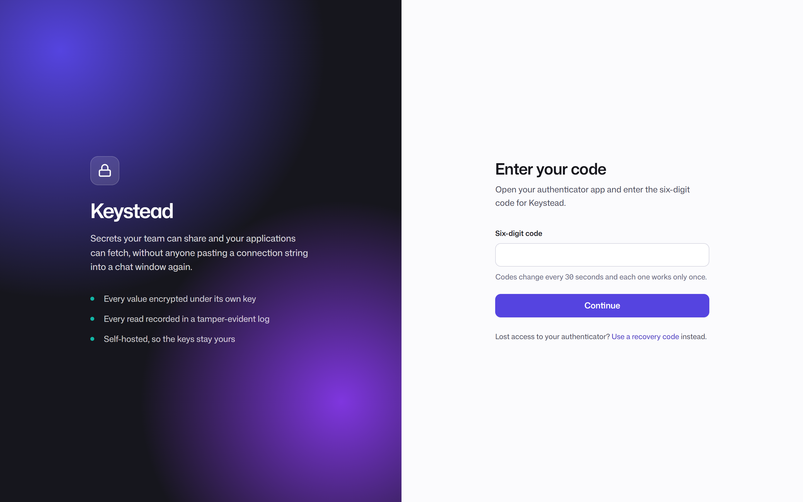</td>
  </tr>
  <tr>
    <td width="58%">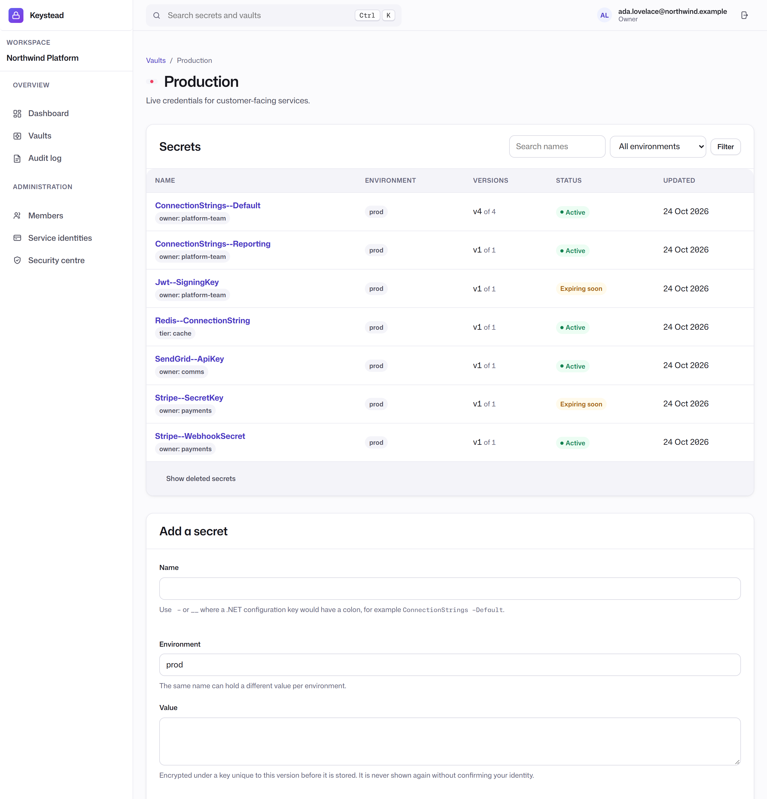</td>
    <td width="42%" valign="top">
      <h3>Vaults and secrets</h3>
      <p>A vault groups secrets that belong together and holds its own encryption key, so access and key rotation are scoped to it rather than to the whole workspace.</p>
      <ul>
        <li>Soft delete, recover and purge, with purge protection</li>
        <li>Tags, environment scoping, expiry and rotation reminders</li>
      </ul>
    </td>
  </tr>
  <tr>
    <td width="42%" valign="top">
      <h3>Revealing a value</h3>
      <p>The value is never in the page markup. Revealing it is a <code>POST</code> with an antiforgery token behind a re-confirmed identity.</p>
      <ul>
        <li>The response carries <code>Cache-Control: no-store</code></li>
        <li>The read is written to the audit log</li>
        <li>The value hides itself again after thirty seconds</li>
      </ul>
    </td>
    <td width="58%">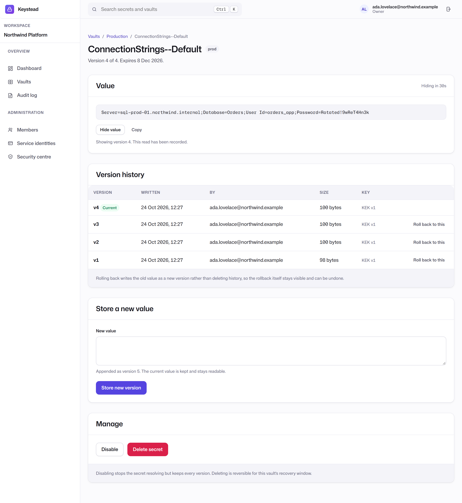</td>
  </tr>
  <tr>
    <td width="58%">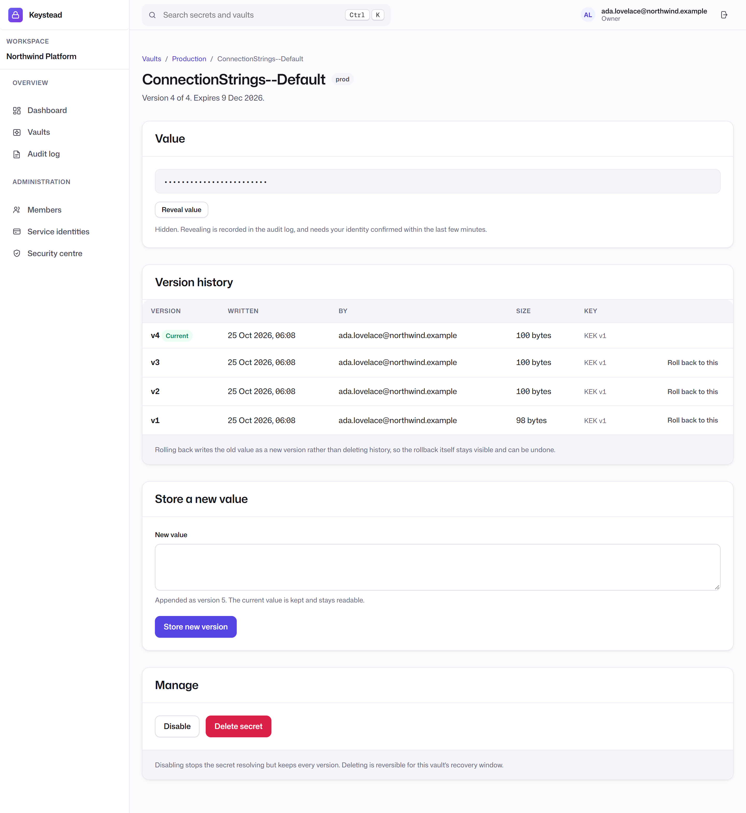</td>
    <td width="42%" valign="top">
      <h3>Versions and rollback</h3>
      <p>Storing a new value appends a version rather than overwriting one.</p>
      <ul>
        <li>Rolling back re-seals the old value as a <i>new</i> version</li>
        <li>History stays append-only, and the rollback is itself auditable and reversible</li>
      </ul>
    </td>
  </tr>
  <tr>
    <td width="42%" valign="top">
      <h3>The audit log</h3>
      <p>Every read, write, sign-in, permission change and refusal, in order. Each entry commits to the one before it over a length-prefixed canonical encoding.</p>
      <ul>
        <li>A chain-verification badge, checked on load</li>
        <li>CSV export guarded against spreadsheet formula injection</li>
      </ul>
    </td>
    <td width="58%">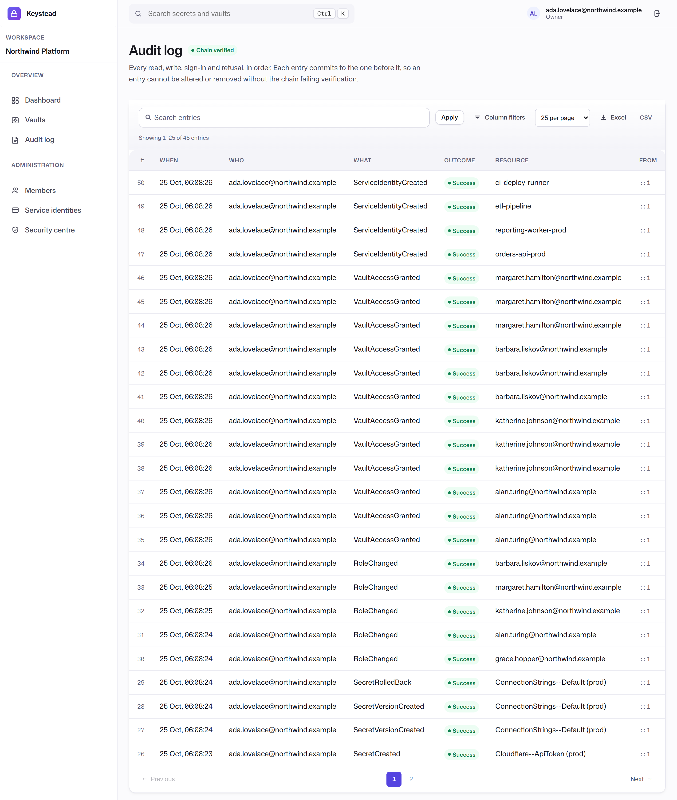</td>
  </tr>
  <tr>
    <td width="58%">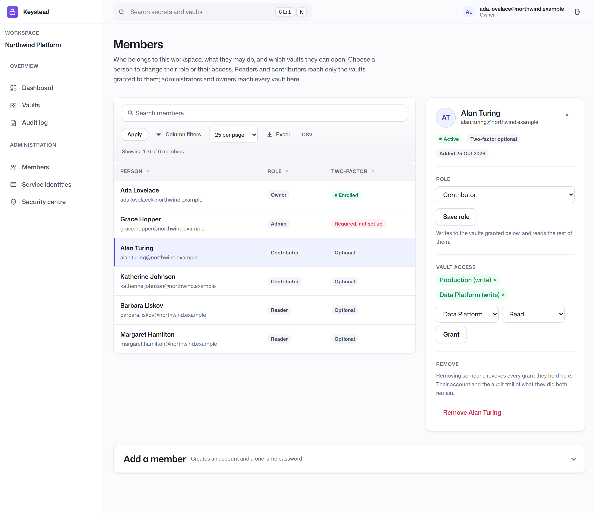</td>
    <td width="42%" valign="top">
      <h3>Members</h3>
      <p>People get a role and, optionally, grants on individual vaults. Choosing a person opens their panel: role, two-factor state, the vaults they can open, and the way out.</p>
      <ul>
        <li>The last-owner rule, and no self-promotion to owner</li>
        <li>New accounts get a one-time password, shown once</li>
      </ul>
    </td>
  </tr>
  <tr>
    <td width="42%" valign="top">
      <h3>Service identities</h3>
      <p>Applications get their own identity with its own credentials and vault scope.</p>
      <ul>
        <li>Client secrets with a checksum, stored as SHA-256, shown once</li>
        <li>Rotation with an overlap window, so a deploy does not have to be atomic</li>
        <li>Optional per-identity IP allowlist</li>
      </ul>
    </td>
    <td width="58%">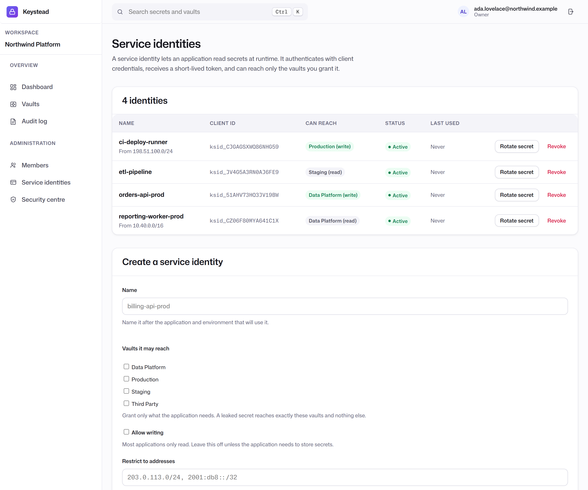</td>
  </tr>
  <tr>
    <td width="58%">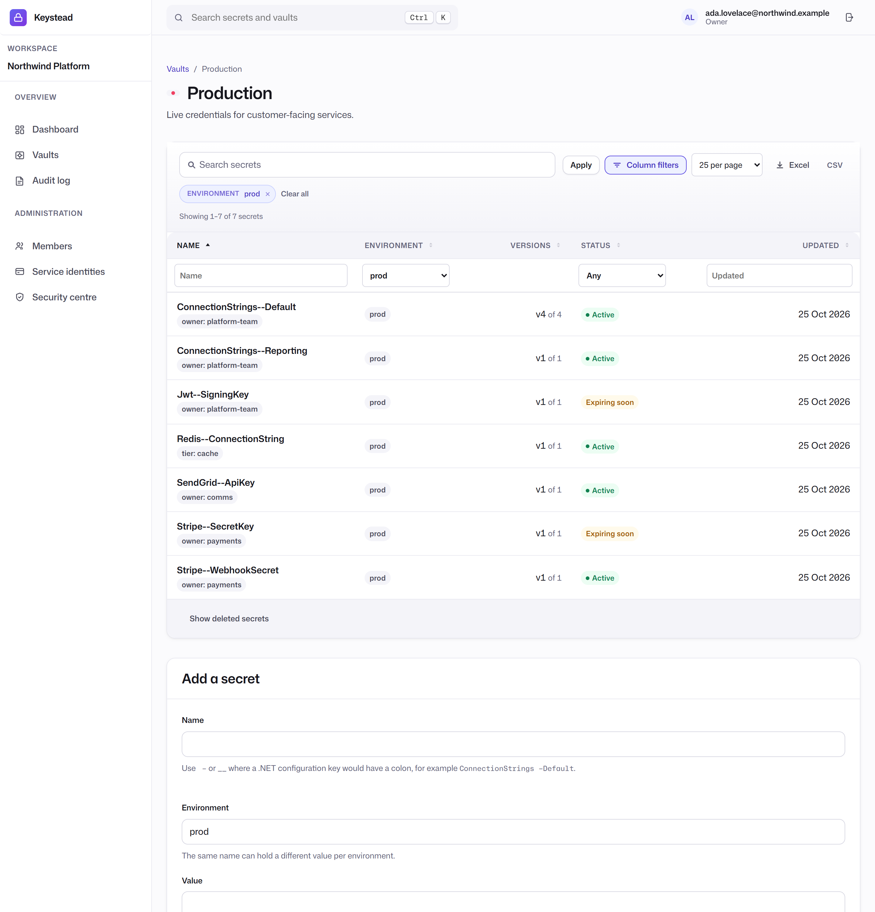</td>
    <td width="42%" valign="top">
      <h3>Every table is the same table</h3>
      <p>Members, vaults, secrets, service identities, sessions and the audit log are all rendered by one engine:</p>
      <ul>
        <li>Search across columns, a filter per column, sort, paging</li>
        <li><b>Download</b> as a real <code>.xlsx</code> workbook or as CSV</li>
        <li>All state lives in the URL, so a filtered view is a link</li>
        <li>Works with scripting blocked</li>
      </ul>
    </td>
  </tr>
  <tr>
    <td width="42%" valign="top">
      <h3>Security centre and palette</h3>
      <p>Where you are signed in, from what, and how to end any of it.</p>
      <ul>
        <li><kbd>Ctrl</kbd> + <kbd>K</kbd> from anywhere opens a command palette built on <code>&lt;dialog&gt;</code>, so focus trapping and <kbd>Esc</kbd> come from the platform</li>
      </ul>
    </td>
    <td width="58%">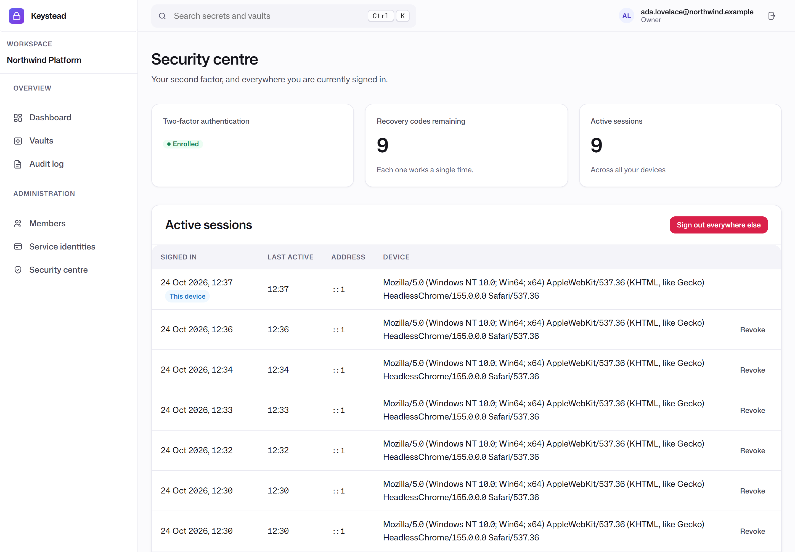</td>
  </tr>
</table>

<p align="right"><a href="#top">↑ back to top</a></p>

## ✦ Screenshot gallery

Every screenshot is of the running application, captured by [`scripts/capture-screenshots.py`](scripts/capture-screenshots.py) against the workspace that [`scripts/seed-workspace.py`](scripts/seed-workspace.py) creates. Nothing is mocked up.

<details>
<summary><b>All 14 screens</b> (click to expand)</summary>

<br>

| | |
|:---:|:---:|
| 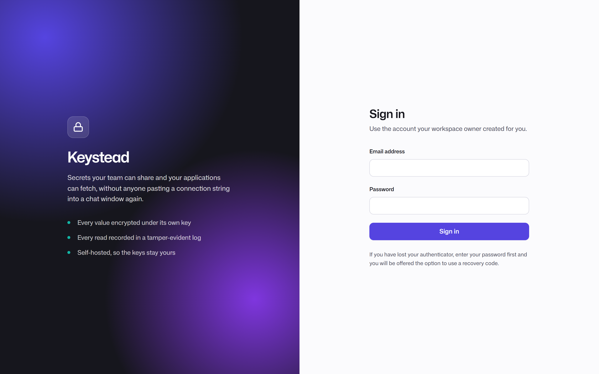<br><sub><b>Sign in</b></sub> | <br><sub><b>Two-factor code</b></sub> |
| <br><sub><b>Dashboard</b></sub> | 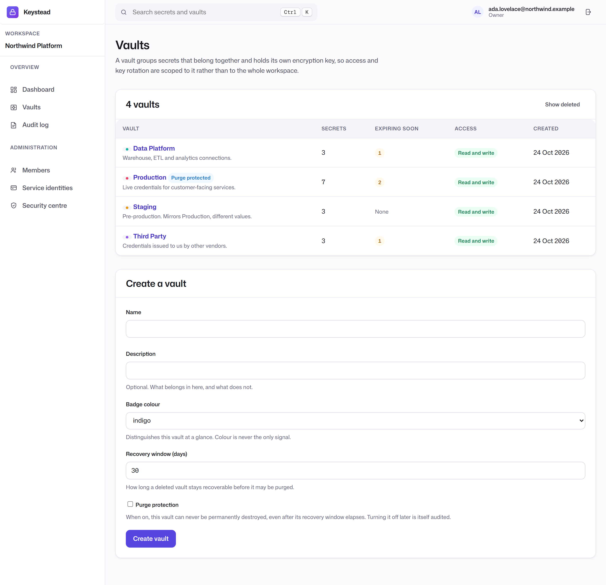<br><sub><b>Vaults</b></sub> |
| <br><sub><b>A vault</b> and its secrets</sub> | <br><sub><b>Filtered</b> by environment</sub> |
| <br><sub><b>A secret</b>, masked by default</sub> | <br><sub><b>Revealed</b> after confirming identity</sub> |
| <br><sub><b>Audit log</b> with chain verification</sub> | 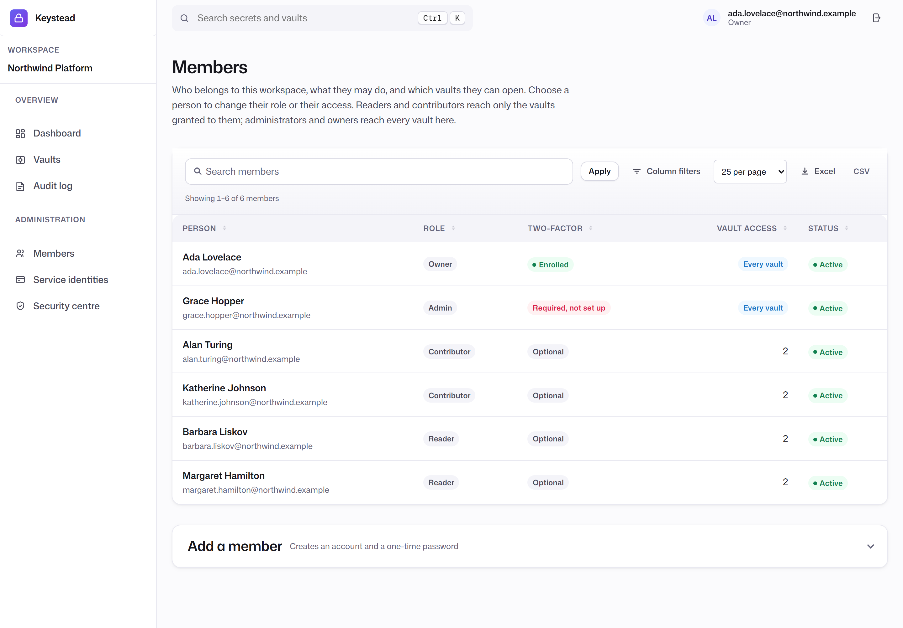<br><sub><b>Members</b></sub> |
| <br><sub><b>A member's access</b></sub> | <br><sub><b>Service identities</b></sub> |
| <br><sub><b>Security centre</b></sub> | 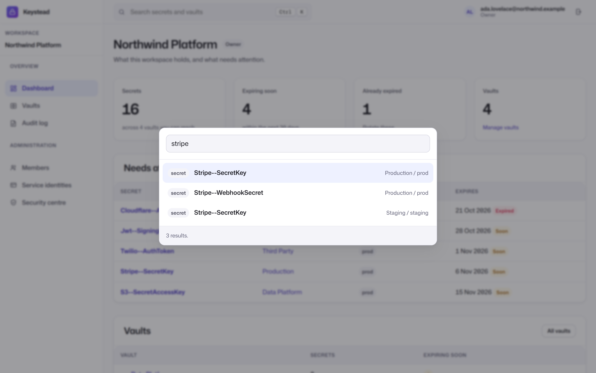<br><sub><b>Command palette</b></sub> |

</details>

<p align="right"><a href="#top">↑ back to top</a></p>

## ✦ Tech stack

<table>
  <tr>
    <th align="left" width="50%">Backend</th>
    <th align="left" width="50%">Interface</th>
  </tr>
  <tr>
    <td valign="top">
      <b>.NET 10</b> and ASP.NET Core<br>
      <b>Clean Architecture</b>: Domain ← Application ← Infrastructure ← Web<br>
      <b>EF Core 10</b> on <b>SQLite</b> (WAL, <code>foreign_keys</code>, busy timeout)<br>
      <b>AES-256-GCM</b> with AAD binding, <b>Argon2id</b> (Konscious)<br>
      <b>ES256 JWTs</b> for the machine API, <b>Otp.NET</b> and <b>QRCoder</b> for TOTP<br>
      <b>FluentValidation</b> and <b>Serilog</b><br>
      <b>OpenAPI</b> document and RFC 7807 problem responses<br>
      <b>System.CommandLine</b> for the CLI
    </td>
    <td valign="top">
      <b>Razor Pages</b>, server-rendered<br>
      A design system in <b>plain CSS</b> with semantic tokens<br>
      Progressive-enhancement JS modules<br>
      No inline script, no inline style, no CDN<br>
      <b>Mona Sans</b> and <b>Mona Sans Mono</b>, self-hosted<br>
      <sub>Everything except revealing a secret and the command palette works with JavaScript disabled.</sub>
    </td>
  </tr>
  <tr>
    <th align="left">Quality</th>
    <th align="left">Tooling</th>
  </tr>
  <tr>
    <td valign="top">
      <b>xUnit</b> unit tests and <b>WebApplicationFactory</b> integration tests<br>
      A dedicated security test project over the real pipeline<br>
      Python smoke, SDK/CLI, load and pentest scripts against a running instance<br>
      <b>CodeQL</b> at security-and-quality
    </td>
    <td valign="top">
      Central Package Management, <code>nullable</code>, warnings as errors, CA security rules at <i>error</i><br>
      <code>dotnet format</code> gate, coverage report, CycloneDX SBOM, Dependabot<br>
      Chiselled non-root Docker image, Caddy and Nginx configs
    </td>
  </tr>
</table>

## ✦ Architecture

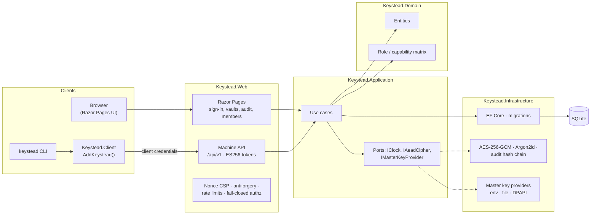

### An application reading a secret

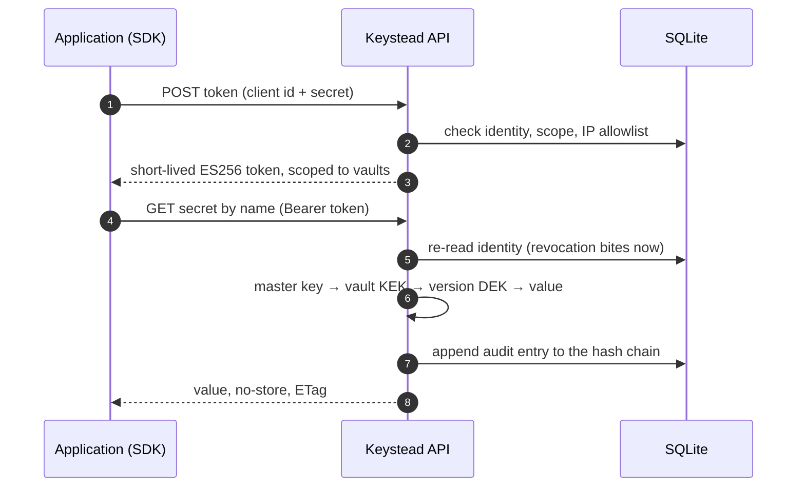

### Why the design looks like this

| Decision | Reason |
|---|---|
| **Envelope encryption, three tiers** | The master key never lives in the database, so a stolen database file is not a stolen secret |
| **Every ciphertext is bound to its row** | AES-GCM AAD covers workspace, vault, secret, version, purpose and key generation. Someone with database write access but no key cannot copy a readable secret's ciphertext into the row of one they cannot read: relocation produces a tag mismatch |
| **Random nonces, never a counter** | The same database can be served by several processes, restored from backup or replicated, and any of those resets a counter. Nonce reuse is catastrophic for GCM, so every seal draws 96 fresh random bits |
| **The audit log is a hash chain** | Length prefixes rather than delimiters, so two different entries cannot serialise to identical bytes. An insider can still rewrite rows, but not without verification failing |
| **Deny by default** | The fallback policy requires an authenticated principal, so an endpoint that forgets a policy fails closed |
| **Revocation bites immediately** | Token validation re-reads the service identity on every call |

<p align="right"><a href="#top">↑ back to top</a></p>

## ✦ Security

Every header, cookie flag and CSP directive this README promises has an assertion in `Keystead.SecurityTests`, run against the real pipeline as `Program` composes it. The threat model is in [THREATMODEL.md](THREATMODEL.md), and how to report a vulnerability is in [SECURITY.md](SECURITY.md).

<details>
<summary><b>Cryptography and keys</b></summary>

- AES-256-GCM AEAD primitive with `CryptoContext` AAD binding.
- `KeyMaterial` zeroes key bytes on disposal.
- Three master key providers: environment, mounted file, and DPAPI / 0600 file.
- Argon2id at 64 MiB / t=3 / p=1, per-user salt, optional pepper, PHC-encoded digests, rehash on upgrade.

</details>

<details>
<summary><b>Identity, sessions and authorization</b></summary>

- Argon2id sign-in with decoy-hash enumeration resistance and progressive lockout.
- TOTP with a single-use replay guard, and 10 single-use recovery codes.
- Server-validated sessions with revocation. Changing your password revokes every other session.
- Role / capability matrix as pure domain logic; vault grants with a role ceiling; workspace scoping and authorization checked separately on every call; step-up re-authentication.
- The first-run wizard closes permanently once an account exists, and the recovery kit shows the master key fingerprint once.

</details>

<details>
<summary><b>Machine API</b></summary>

- OAuth2 client credentials to a short-lived ES256 token, with a rotatable signing key, scoped per vault.
- The token suite performs the classic JWT attacks and asserts each is refused: `alg: none`, HS256 confusion, a token signed by an attacker's key claiming the server's key id, a tampered signature, a missing key id, an expired token, and a token held by a revoked identity.
- RFC 7807 problem documents, ETag revalidation and `no-store` throughout.

</details>

<details>
<summary><b>Web hardening and source rules</b></summary>

- Strict nonce CSP from `default-src 'none'`; the full header set; `no-store`; no `Server` banner; global antiforgery; configurable rate-limit policies; Kestrel limits.
- Source rules enforce what no runtime test can reach: no `Html.Raw`, no inline script, style or event handler, no `eval`, no `innerHTML`, no CDN, no concatenated SQL, no weak primitive, no cipher mode but GCM, no equality operator on secret-derived bytes, and no unfinished placeholder in any file that touches a key.

</details>

## ✦ Testing and verification

**715 tests, all passing.** The failure cases carry the weight: tampered ciphertext, nonce and tag; wrong key; ciphertext moved to another workspace, vault, secret or version; purpose confusion; nonce uniqueness across 200 seals; audit chain edits, deletes and reordering; the full role matrix checked exhaustively; TOTP replay; and cross-tenant access attempted from six directions and refused each time.

| Suite | Result |
|---|---|
| Unit tests: crypto, hashing, audit chain, identity, RBAC | **569 passed** |
| Integration tests (`WebApplicationFactory`, whole flow) | **25 passed** |
| Security tests: headers, CSP, cookies, rate limits, source rules | **121 passed** |
| Build | **Warnings as errors**, CA security rules at *error* |

**Against a running instance**, five scripts drive the real application over HTTP rather than in-process:

| Script | What it does |
|---|---|
| [`seed-workspace.py`](scripts/seed-workspace.py) | Builds a realistic installation (four vaults, sixteen secrets, six members, four service identities, version history and a rollback) entirely through the public interface |
| [`smoke-flow.py`](scripts/smoke-flow.py) | **81 assertions** over the whole flow, including that a secret value appears in no list page, detail page, browser `GET`, API list response, audit row or CSV export |
| [`verify-sdk-cli.py`](scripts/verify-sdk-cli.py) | **29 more** against the SDK, the CLI and the OpenAPI document |
| [`pentest-probe.py`](scripts/pentest-probe.py) | **21 real attacks** (forged tokens, `alg: none`, cross-vault reads, CSRF, open redirects, path traversal, stored script, mass assignment), each of which must be refused |
| [`load-test.py`](scripts/load-test.py) | **1,000 concurrent callers** through three scenarios, counting outcomes by status so a 429 reads as the limiter working rather than as a failure |

```bash
dotnet test
```

```bash
python scripts/smoke-flow.py https://localhost:5001
```

<details>
<summary><b>What running and attacking it turned up</b></summary>

<br>

Running and measuring the application found four defects that no build, test or review had: every inline style silently discarded by the Content Security Policy, a self-hosted font that was never in the repository, a full Argon2id hash on every request including anonymous ones, and a rate limit that counted page views and locked users out of signing in.

Attacking it found six more. Two were worse than the first write-up of them. The machine API's rate limits were keyed by source address, so eight service identities behind one address shared one budget and 872 of a thousand reads were refused. And the reverse proxy configuration an operator writes was **never applied at all**, because the configuration binder cannot turn `"172.16.0.0/12"` into an `IPNetwork` and dropped it in silence. Any installation behind a proxy compared the proxy's address against a service identity's IP allowlist, and treated every caller on the internet as one client for rate limiting.

Those are fixed and measured, as are a step-up flow that returned people to a page where nothing had visibly happened and a `no-store` that also applied to the font. One finding is accepted as designed behaviour and written down rather than patched: the audit chain fails an action rather than lose an entry.

Every measurement, the load test results, all twenty-one attack attempts and the before-and-after numbers are in **[FINDINGS.md](FINDINGS.md)**.

</details>

### Known gaps

There is no JWKS endpoint: the public keys are stored and usable but not published. Master-key and vault KEK rotation are modelled and stored but have no background job to run them; token signing key rotation is implemented and tested. Revealing a secret and the command palette both require JavaScript. See [TRACEABILITY.md](TRACEABILITY.md) for every requirement mapped to its implementation and test, or to the reason it is absent.

> [!CAUTION]
> `KeyMaterial` zeroes key bytes on disposal, which bounds how long a key sits in memory. It does not guarantee the key was never copied: the CLR may relocate an array during a compacting collection, and nothing in managed code defends against a memory dump taken while a key is live. That is why the master key provider interface is shaped to let a remote KMS do the wrapping instead.
>
> This is a portfolio project, built to the standard its subject matter demands and attacked, measured and documented honestly, including the parts that are not finished. It has not been through an independent security review, and software that holds other people's secrets should have one before it holds yours.

## ✦ Design

The interface is a design system in plain CSS with semantic tokens over an indigo, teal and ink palette, in [`src/Keystead.Web/wwwroot/css/keystead.css`](src/Keystead.Web/wwwroot/css/keystead.css). The type is Mona Sans, with Mona Sans Mono for keys and values, both self-hosted.

The members page is a list beside a panel rather than a table carrying five controls on every row. A table that needs a horizontal scrollbar at 1440 px is a table that has been asked to do two jobs. In every table a column is declared once, and that one declaration is the header, the filter, the sort key and the export column, so a spreadsheet never quietly stops matching the screen it was taken from.

## ✦ Project layout

```
src/
  Keystead.Domain           entities and domain rules; references nothing
  Keystead.Application      use cases and ports (IClock, IAeadCipher, IMasterKeyProvider)
  Keystead.Infrastructure   EF Core, cryptography, key providers, migrations
  Keystead.Web              Razor Pages UI and the machine API under /api/v1
  Keystead.Client           SDK and the AddKeystead() configuration provider
  Keystead.Cli              the `keystead` dotnet tool
tests/
  Keystead.Tests              unit tests (crypto, hashing, audit chain, identity)
  Keystead.IntegrationTests   WebApplicationFactory suites over the whole flow
  Keystead.SecurityTests      headers, CSP, cookie flags, rate limits, source rules
samples/                    a sample web app using the SDK
deploy/                     Caddy and Nginx reverse proxy configs
scripts/                    seeding, screenshots, smoke flow, load test, attack probe
images/                     screenshots used in this README
```

| Document | What it is for |
|---|---|
| [FINDINGS.md](FINDINGS.md) | What running, measuring and attacking it turned up, what was fixed, and what was accepted instead |
| [CLAUDE.md](CLAUDE.md) | The conventions and non-negotiable security rules for any change here |
| [PLAN.md](PLAN.md) | The design and the milestone plan |
| [THREATMODEL.md](THREATMODEL.md) | STRIDE table, and a limitations section that is not a formality |
| [SECURITY.md](SECURITY.md) | How to report a vulnerability, and what is in scope |
| [DEPLOYMENT.md](DEPLOYMENT.md) | How to run it, ordered by what breaks worst if you get it wrong |
| [TRACEABILITY.md](TRACEABILITY.md) | Every requirement mapped to its implementation and test, or to why it is absent |

To refresh the screenshots, run the application with a seeded workspace and then:

```bash
python scripts/capture-screenshots.py
```

<sub>The fonts in `src/Keystead.Web/wwwroot/fonts` are Mona Sans and Mona Sans Mono, used under the SIL Open Font Licence; the licence travels with them in that directory.</sub>

<br>

<div align="center">

**Keystead** · crafted in Karachi

© 2026 [masimaziz.com](https://masimaziz.com/) · [asimhashmi47@gmail.com](mailto:asimhashmi47@gmail.com)

<a href="#top">↑ back to top</a>

</div>
